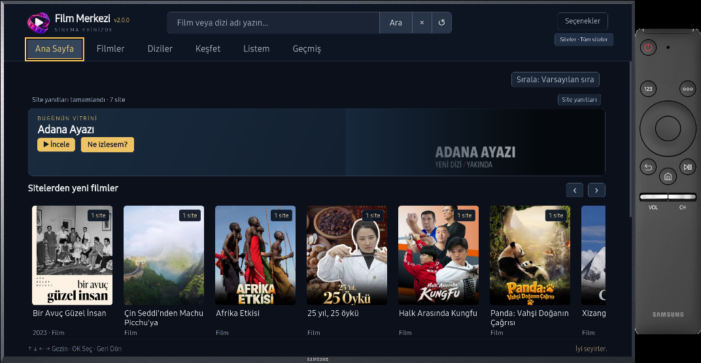
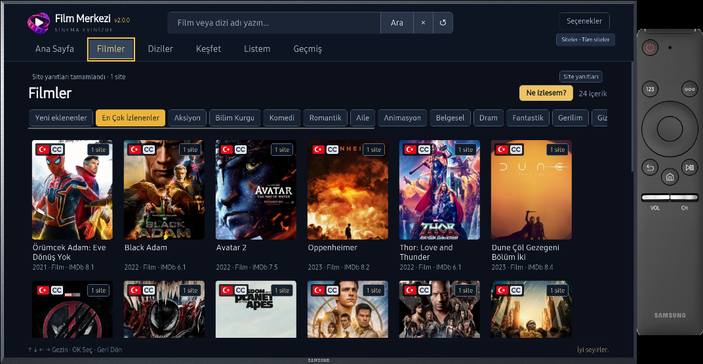
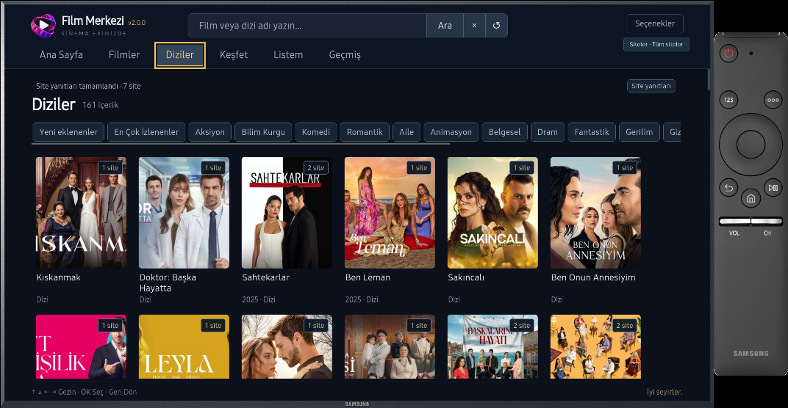
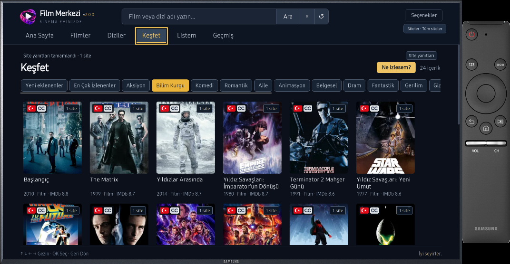

# Film Merkezi

Samsung Tizen TV’ler için ücretsiz ve açık kaynaklı bir **medya merkezi**. Desteklenen web kaynaklarının katalog ve videolarını TV kumandasına uygun bir arayüzde sunar.

**2.x yapısı:** Site ve çözümleyiciler kullanıcının seçtiği depolardan ayrı paketler olarak kurulur. WGT hazır site veya önceden seçili depo içermez.

## Son güncelleme · WGT 2.0.1 / Çekirdek 2.1.8

- ÇizgiFilm/Anime ve Drama/Short kategorileri, menü ve kumanda düzenlemeleri.
- İlk kurulumdan önce çekirdek denetimi, kaynakların kullanabildiği 24 MiB taşıma tavanı.
- Eski kurulumları koruyan ayrı güncelleme kanalı ve paket işlemlerinde kararlılık düzeltmesi.

Bu sürüm için [WGT 2.0.1'i kurun](https://github.com/enesk4yh4n-lab/TizenTV-Film-Merkezi/releases/tag/v2.0.1). WGT 2.0.0 mevcut uyumlu kanalında kalır; yeni çekirdek ve yeni eklenti özellikleri için WGT güncellemesi gerekir. Ayrıntılar: [Sürüm notları](CHANGELOG.md).

## Özellikler

- Ortak arama, filtreleme ve içerik birleştirme.
- Listem, kaldığın yerden devam ve bölüm takibi.
- HTML5/hls.js ve Samsung AVPlay; kalite, ses ve altyazı seçenekleri.
- Türkçe/İngilizce arayüz, uygulama içi güncellemeler ve isteğe bağlı hata bildirimi.

## Ekran görüntüleri

Çekirdek 2.1.5 ile **gerçek Tizen 3 emülatöründen** alınmıştır; yeni sürümde Keşfet yerine ÇizgiFilm/Anime ve Drama/Short bulunur. Görseller, kullanıcının eklediği depolarla oluşan örnek görünümü gösterir; WGT hazır site veya depo içermez.

| Ana Sayfa | Filmler · En Çok İzlenenler |
|---|---|
|  |  |
| **Diziler** | **Keşfet · Bilim Kurgu** |
|  |  |

## Kurulum

[Releases](https://github.com/enesk4yh4n-lab/TizenTV-Film-Merkezi/releases) bölümündeki güncel **public WGT** dosyasını Apps2Samsung ile kurabilirsiniz. Kullanım sırasında bilgisayar veya yerel sunucu gerekmez.

- [Ekran görüntülü TV’ye kurulum kılavuzu](docs/KURULUM.md)
- [Ekran görüntülü depo ve eklenti kurulum kılavuzu](docs/DEPO_EKLEME.md)

İlk kurulumda dil, kullanım bilgilendirmesi, depo, birleştirme ve arama tercihleri adım adım sunulur. Hazır site veya önceden seçili depo gelmez; depo eklemeden devam edebilirsiniz. [Eklenti SDK 2.0.1](https://github.com/enesk4yh4n-lab/Film-Merkezi-Eklentiler/blob/main/SDK/README.md) kullanılabilir; ayrı grafik arayüz henüz yayımlanmamıştır.

## Depo bulma

**Güncelleme Merkezi → Depolar → GitHub’da depo ara** açıldığında uyumlu depolar listelenir. Depo adı veya GitHub kullanıcı adıyla ayrıca arayabilirsiniz. Seçtiğiniz depo doğrulandıktan sonra **Ekle** deyin. Doğrudan HTTPS adresi ekleme de kullanılabilir.

**WGT 2.0.1:** Depo dosyasının adı **filmmerkezi201-repository.json** olur. WGT 2.0.0, mevcut **filmmerkezi-repository.json** listesini ve uyumlu çekirdek kanalını kullanmaya devam eder. SDK, GitHub aramasında bulunabilmesi için README açıklamasını ve dosya yolunu hazırlar. Arama sonucunda görünmek bir güvenilirlik veya içerik onayı değildir.

<!-- film-merkezi-repository: filmmerkezi-repository.json -->
<!-- film-merkezi201-repository: filmmerkezi201-repository.json -->

Uygulamadaki GitHub depo aramasında **Film-Merkezi** aratarak bulunan depoları ekleyebilirsiniz.

Tizen 3.0 hedeflenerek geliştirilmiştir. Uyumluluk TV modeline ve kaynağa bağlıdır. Genel amaçlı bir web tarayıcısı değildir; harici sitelerdeki değişiklikler çalışmasını etkileyebilir. Yetişkin içeriklerini göstermemeye yönelik filtreleme bulunur.

## Lisans ve teşekkürler

Proje [MIT lisanslıdır](uygulama/LICENSE). Üçüncü taraf bileşenler kendi lisanslarına tabidir; katkı sağlayan geliştiricilere ve Apps2Samsung ekibine teşekkür ederiz. [Lisanslar ve teşekkürler](uygulama/THIRD_PARTY_NOTICES.md).

**İletişim:** destekfilmmerkezi@gmail.com
