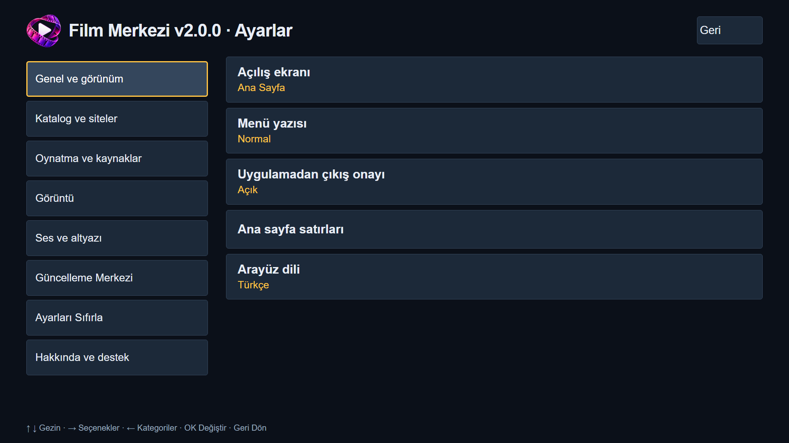

# Film Merkezi

Samsung Tizen TV’ler için ücretsiz ve açık kaynaklı bir **medya merkezi**. Desteklenen web kaynaklarının katalog ve videolarını TV kumandasına uygun bir arayüzde sunar.

**Yeni yapı:** Uygulamanın mimarisi tamamen yenilendi. Eski sürümler güncel dağıtımdan kaldırıldı; eski biçimdeki eklentiler yeni yapıda çalışmaz. Site ve çözümleyiciler artık kullanıcının seçtiği depolardan ayrı paketler olarak kurulur.

## Özellikler

- Ortak arama, filtreleme ve içerik birleştirme.
- Listem, kaldığın yerden devam ve bölüm takibi.
- HTML5/hls.js ve Samsung AVPlay; kalite, ses ve altyazı seçenekleri.
- Türkçe/İngilizce arayüz, uygulama içi güncellemeler ve isteğe bağlı hata bildirimi.

## Kurulum

[Releases](https://github.com/enesk4yh4n-lab/TizenTV-Film-Merkezi/releases) bölümündeki güncel **public WGT** dosyasını Apps2Samsung ile kurabilirsiniz. Kullanım sırasında bilgisayar veya yerel sunucu gerekmez.

- [Ekran görüntülü TV’ye kurulum kılavuzu](docs/KURULUM.md)
- [Ekran görüntülü depo ve eklenti kurulum kılavuzu](docs/DEPO_EKLEME.md)

İlk kurulumda dil ve birleştirme tercihi, kullanım bilgilendirmesi ve depo seçimi bulunur. Hazır site veya önceden seçili depo gelmez; depo eklemeden devam edebilirsiniz. [Eklenti SDK 2.0.0](SDK/README.md) kullanılabilir; ayrı grafik arayüz henüz yayımlanmamıştır.

## Depo bulma

**Güncelleme Merkezi → Eklenti depoları → GitHub’da depo ara** yolundan depo adı veya GitHub kullanıcı adıyla arayın. Seçtiğiniz depo doğrulandıktan sonra **Ekle** deyin. Doğrudan HTTPS adresi ekleme de kullanılabilir.

Depo dosyasının adı **filmmerkezi-repository.json** olmalıdır. SDK, GitHub aramasında bulunabilmesi için README açıklamasını ve dosya yolunu otomatik hazırlar. Eski dosya adı desteklenmez. Arama sonucunda görünmek bir güvenilirlik veya içerik onayı değildir.

Uygulamadaki GitHub depo aramasında **Film-Merkezi** aratarak bulunan depoları ekleyebilirsiniz.

*Uygulamanın gerçek arayüzü; görsel yalıtılmış Chromium ortamında alınmıştır.*

Tizen 3.0 hedeflenerek geliştirilmiştir. Uyumluluk TV modeline ve kaynağa bağlıdır. Genel amaçlı bir web tarayıcısı değildir; harici sitelerdeki değişiklikler çalışmasını etkileyebilir. Yetişkin içeriklerini göstermemeye yönelik filtreleme bulunur.

## Lisans ve teşekkürler

Proje [MIT lisanslıdır](uygulama/LICENSE). Üçüncü taraf bileşenler kendi lisanslarına tabidir; katkı sağlayan geliştiricilere ve Apps2Samsung ekibine teşekkür ederiz. [Lisanslar ve teşekkürler](uygulama/THIRD_PARTY_NOTICES.md).

**İletişim:** destekfilmmerkezi@gmail.com
