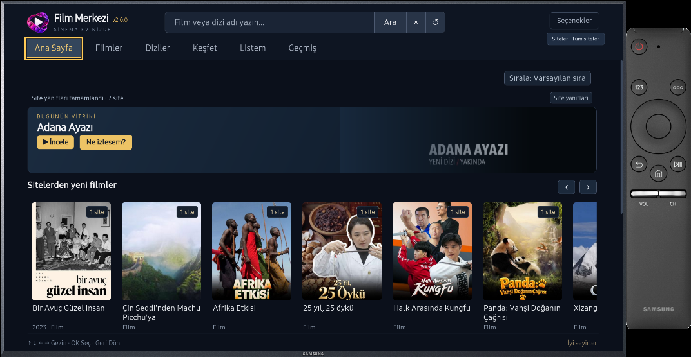
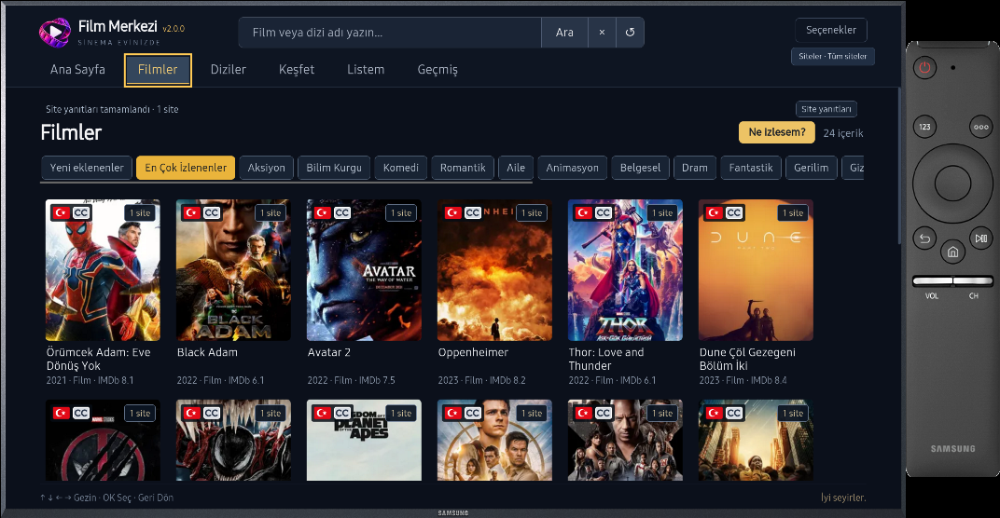
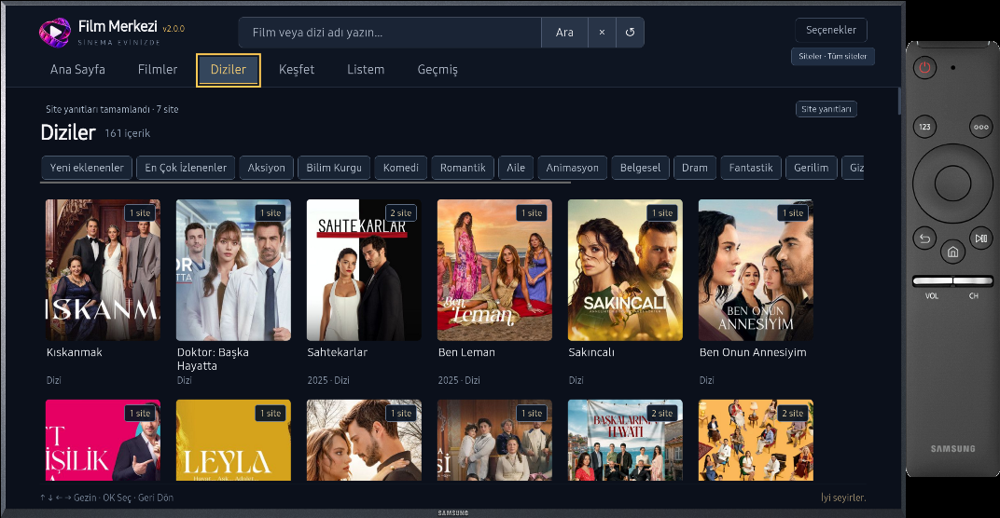
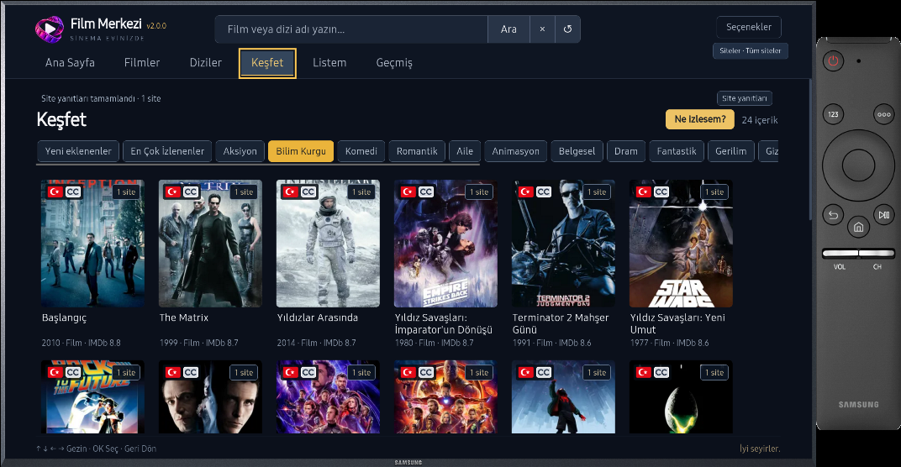

# Film Merkezi

Samsung Tizen TV’ler için ücretsiz ve açık kaynaklı bir **medya merkezi**. Desteklenen web kaynaklarının katalog ve videolarını TV kumandasına uygun bir arayüzde sunar.

**2.x yapısı:** Site ve çözümleyiciler kullanıcının seçtiği depolardan ayrı paketler olarak kurulur. WGT hazır site veya önceden seçili depo içermez.

## Son güncelleme · Film Merkezi TV 2.0.3

- Yeni Tizen sürümlerinde video bağlantısı uyumluluğu genişletildi.
- Yarım kalan eklenti indirmelerine devam edilebilir. Yeni TV paketi gerektiğinde Güncelleme Merkezi bilgi verir.
- Çekirdek indirmesinde ilerleme gösterilir. Güncelleme hazır olduğunda sürüm notlarından uygulamayı yeniden başlatabilirsiniz.

[WGT 2.0.3 ve ayrıntılı sürüm notları](https://github.com/enesk4yh4n-lab/TizenTV-Film-Merkezi/releases/tag/v2.0.3)

## Özellikler

- Ortak arama, filtreleme ve içerik birleştirme.
- Listem, kaldığın yerden devam ve bölüm takibi.
- HTML5/hls.js ve Samsung AVPlay; kalite, ses ve altyazı seçenekleri.
- Türkçe/İngilizce arayüz, uygulama içi güncellemeler ve isteğe bağlı hata bildirimi.

## Ekran görüntüleri

Çekirdek 2.1.5 ile **gerçek Tizen 3 emülatöründen** alınmıştır; yeni sürümde Keşfet yerine ÇizgiFilm/Anime ve Drama/Short bulunur. Görseller, kullanıcının eklediği depolarla oluşan örnek görünümü gösterir; WGT hazır site veya depo içermez.

| Ana Sayfa | Filmler · En Çok İzlenenler |
|---|---|
|  |  |
| **Diziler** | **Keşfet · Bilim Kurgu** |
|  |  |

## Kurulum

[Releases](https://github.com/enesk4yh4n-lab/TizenTV-Film-Merkezi/releases) bölümündeki güncel **public WGT** dosyasını Apps2Samsung ile kurabilirsiniz. Kullanım sırasında bilgisayar veya yerel sunucu gerekmez.

- [Ekran görüntülü TV’ye kurulum kılavuzu](docs/KURULUM.md)
- [Ekran görüntülü depo ve eklenti kurulum kılavuzu](docs/DEPO_EKLEME.md)

İlk kurulumda dil, kullanım bilgilendirmesi, depo, birleştirme ve arama tercihleri adım adım sunulur. Hazır site veya önceden seçili depo gelmez; depo eklemeden devam edebilirsiniz. [Eklenti SDK 2.0.2](https://github.com/enesk4yh4n-lab/Film-Merkezi-Eklentiler/blob/main/SDK/README.md) kullanılabilir; ayrı grafik arayüz henüz yayımlanmamıştır.

## Depo bulma

**Güncelleme Merkezi → Depolar → GitHub’da depo ara** açıldığında uyumlu depolar listelenir. Depo adı veya GitHub kullanıcı adıyla ayrıca arayabilirsiniz. Seçtiğiniz depo doğrulandıktan sonra **Ekle** deyin. Doğrudan HTTPS adresi ekleme de kullanılabilir.

WGT 2.0.3 için depo dosyasının adı [filmmerkezi-repository.json](filmmerkezi-repository.json). Daha eski bir depo adresine kayıtlıysanız [depo kılavuzundaki geçiş adımını](docs/DEPO_EKLEME.md#3-aramayla-bulamazsanız-adres-kullanın) izleyin.

<!-- film-merkezi-repository: filmmerkezi-repository.json -->

Uygulamadaki GitHub depo aramasında **Film-Merkezi** aratarak bulunan depoları ekleyebilirsiniz.

Tizen 3.0 hedeflenerek geliştirilmiştir. Uyumluluk TV modeline ve kaynağa bağlıdır. Genel amaçlı bir web tarayıcısı değildir; harici sitelerdeki değişiklikler çalışmasını etkileyebilir. Yetişkin içeriklerini göstermemeye yönelik filtreleme bulunur.

## Lisans ve teşekkürler

Proje [MIT lisanslıdır](uygulama/LICENSE). Üçüncü taraf bileşenler kendi lisanslarına tabidir; katkı sağlayan geliştiricilere ve Apps2Samsung ekibine teşekkür ederiz. [Lisanslar ve teşekkürler](uygulama/THIRD_PARTY_NOTICES.md).

**İletişim:** destekfilmmerkezi@gmail.com
