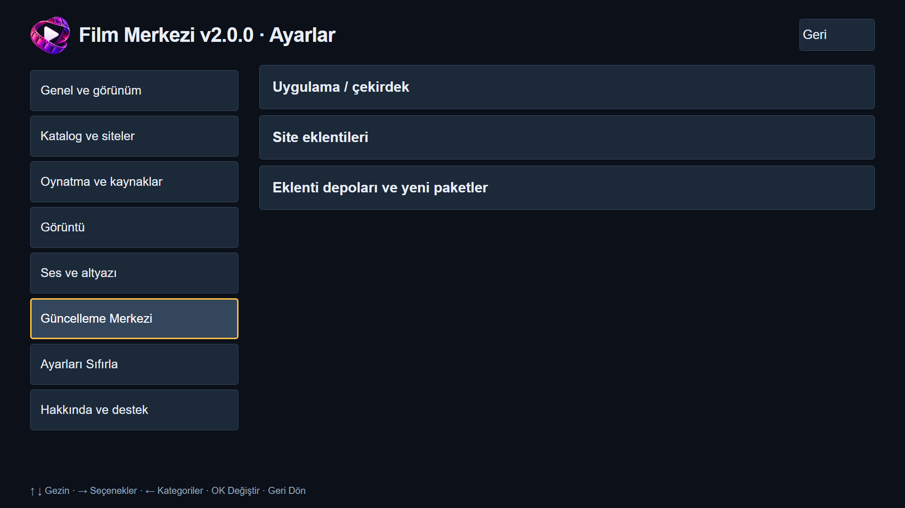
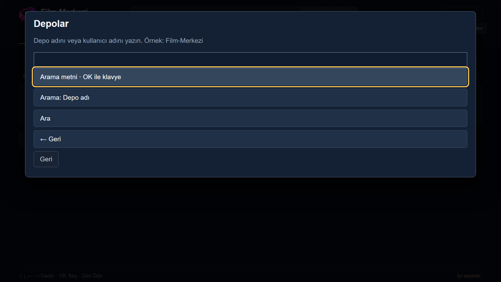
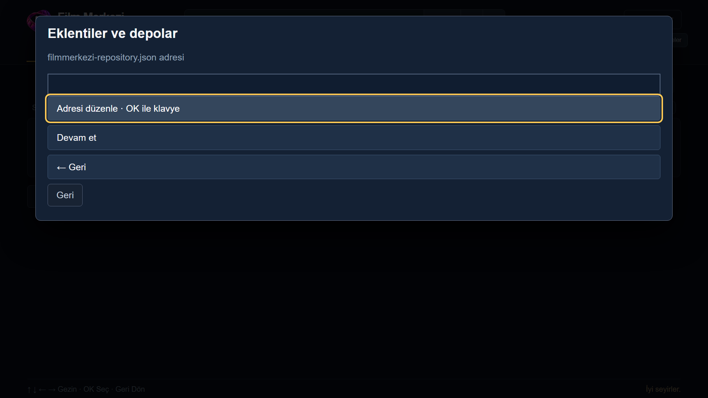

# Film Merkezi — depo ve eklenti ekleme

[Ana sayfa](../README.md) · [TV’ye kurulum](KURULUM.md)

Depo, kurulabilecek site ve çözümleyici paketlerinin listesidir. Eklemek bütün paketlerini otomatik kurmaz. Yalnız güvendiğiniz yayıncıları ekleyin.

## 1. Depolar ekranını açın

İlk kurulumdaki **Depolar** ekranından veya boş ana sayfadaki **Depo ekle** düğmesinden başlayabilirsiniz. Sonradan erişmek için:

**Seçenekler → Güncelleme Merkezi → Eklenti depoları ve yeni paketler**

## 2. GitHub’da arayın

**GitHub’da depo ara** seçeneğini açın. **Arama metni · OK ile klavye** üzerinden depo adını yazıp **Ara** deyin. Kullanıcı adıyla aramak için arama türünü değiştirin.

**TizenTV-Film-Merkezi** adıyla ana depoyu arayıp yalnız Puhutv için **P002** site paketini kurabilirsiniz; **R002** çözümleyicisi bağımlılık olarak birlikte sunulur. **Film-Merkezi-Eklentiler** deposu da aynı Puhutv paketlerini sunar. Birinden kurmanız yeterlidir; ikinci depodan aynı paketi tekrar kurmayın. Yeni depoların GitHub aramasında görünmesi gecikebilir. Bu form görüntüsü, depoların yayımlandığı veya aramada bulunduğu anlamına gelmez.

Sonuçtan depoyu seçin. Gösterilen ad/adresi kontrol edip güveniyorsanız **Ekle** deyin. Teknik ayrıntıları açmak zorunlu değildir. Arama sonucu bir içerik/yayıncı onayı değildir.

## 3. Aramayla bulamazsanız adres kullanın

**+ Adresle depo ekle → Adresi düzenle · OK ile klavye** yolundan GitHub depo bağlantısını veya doğrudan HTTPS indeks adresini girin. **Devam et** sonrasında inceleyip **Ekle** deyin.

WGT **2.0.1** için indeks adı **`filmmerkezi201-repository.json`** olur. WGT **2.0.0** kullananlar mevcut **`filmmerkezi-repository.json`** listesinde kalır. Yayıncıdan aldığınız sürümünüze uygun adresi kullanın. İmza veya HTTPS doğrulaması başarısızsa depo eklenmez.

## 4. Paketi kurun

Eklenen depoda **Eklentilere gözat** deyin. Site paketini seçip **Kurulumu incele** üzerinden gerekli çözümleyicileri de içeren özeti okuyun ve paketleri yükleyin. Gerekli çözümleyici siteyle birlikte kurulum planına alınır.

İndirme/doğrulama tamamlanınca **Uygula ve yeniden aç** deyin. Yeniden açılışta kurulan etkin siteler katalogda kullanılabilir olur. Eklenti sürümünün uygulamanızla uyumlu olması gerekir.

## Güncelleme ve yönetim

- **Güncelleme Merkezi → Kontrol et:** Çekirdek ve etkin depoların eklenti güncellemelerini birlikte denetler. Bulunan güncellemeleri inceleyip yükleyin.
- **Depo adını değiştir:** Yalnız bu TV’de görünen adı değiştirir.
- **Depoyu kaldır:** O depodan kurulan eklentileri de kaldırır; Listem ve izleme kayıtlarını silmez.
- **Depo bulunamadı / GitHub sınırı:** Bekleyin veya yayıncıdan doğru HTTPS adresini alın.

*Görseller uygulamanın kendi arayüzünden, yalıtılmış Chromium ortamında alınmıştır. Görsellerde arama, ekleme veya kurulum sonucu canlandırılmamıştır.*
