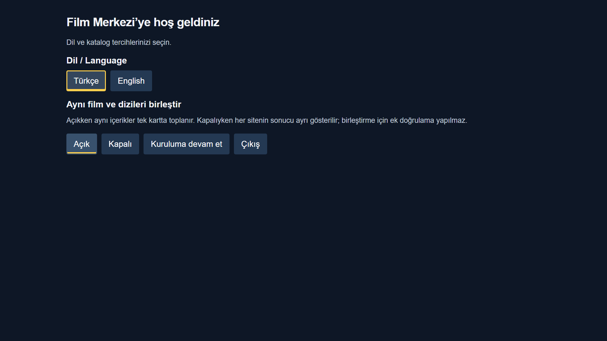
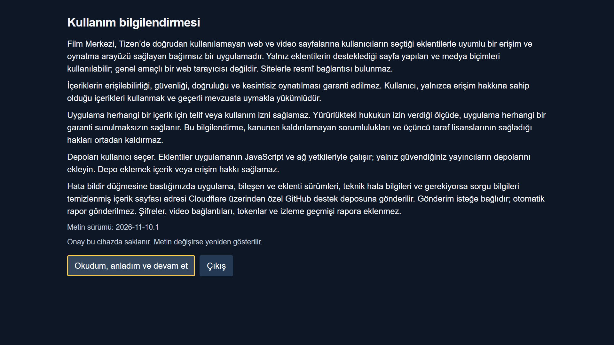
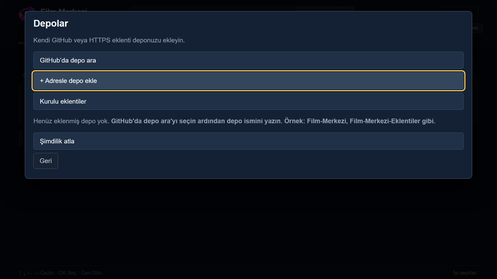

# Film Merkezi — TV’ye kurulum

[Ana sayfa](../README.md) · [Depo ve eklenti ekleme](DEPO_EKLEME.md)

## 1. Dosyayı indirin

[Releases](https://github.com/enesk4yh4n-lab/TizenTV-Film-Merkezi/releases) bölümünden güncel **public WGT** dosyasını indirin. Kaynak ZIP’ini veya geliştirici imzalı test paketini seçmeyin.

## 2. TV bağlantısını hazırlayın

TV ve kurulumu yapacak telefon/bilgisayar aynı yerel ağda olsun. TV’de **Apps** ekranını açıp **12345** girerek Developer Mode’u etkinleştirin. Host IP alanına TV’ye bağlanacak cihazın yerel IP adresini yazın ve TV’yi yeniden başlatın. Modele göre farklılık varsa Apps2Samsung’un yönlendirmesini izleyin. [Resmî bağlantı yönergeleri](https://github.com/Apps2Samsung/Apps2Samsung/wiki/FAQ#-how-to-enable-developer-mode-on-your-tv).

## 3. Apps2Samsung ile yükleyin

[Apps2Samsung](https://github.com/Apps2Samsung/Apps2Samsung) uygulamasını açıp TV’nizi seçin. Kendi WGT dosyanızı yükleme seçeneğinden indirdiğiniz **public WGT** dosyasını seçin. Sertifika/Samsung oturumu istenirse uygulamanın akışını tamamlayın. Düğme adları sürüme göre değişebilir. [Apps2Samsung kurulum açıklaması](https://github.com/Apps2Samsung/Apps2Samsung#how-it-works).

Kurulum bitince TV’nin Apps ekranından **Film Merkezi**’ni açın.

## 4. İlk açılışı tamamlayın

**Dil ve birleştirme:** Dili ve birleştirme tercihini seçip devam edin. Yeni kurulumda birleştirme açıktır.

**Kullanım bilgilendirmesi:** Metni okuyup kabul ediyorsanız devam edin.

**Depolar:** Depo ekleyebilir veya **Şimdilik atla** ile ana sayfaya geçebilirsiniz. Uygulamayla hazır site/depo gelmez.

Depo eklemeden geçildiğinde boş ana sayfa normaldir. [Depo ve eklenti kurulumuna devam edin](DEPO_EKLEME.md).

## Kurulum takılırsa

- **TV bulunamıyor:** Aynı ağı, Developer Mode’u ve Host IP’yi kontrol edin.
- **Sertifika/imza hatası:** Apps2Samsung’un sertifika yönlendirmesini izleyin. Farklı imzalı eski kurulumun kaldırılması gerekebilir; kaldırma uygulamanın yerel verilerini silebilir. Kaldırmayı ilk çözüm olarak uygulamayın.
- **İçerik yok:** Önce depo ve site paketini ekleyin; bu durum tek başına bağlantı hatası değildir.

*Görseller uygulamanın gerçek temiz kurulum arayüzünden, yalıtılmış Chromium ortamında alınmıştır. Fiziksel TV veya Apps2Samsung ekran görüntüsü değildir.*
